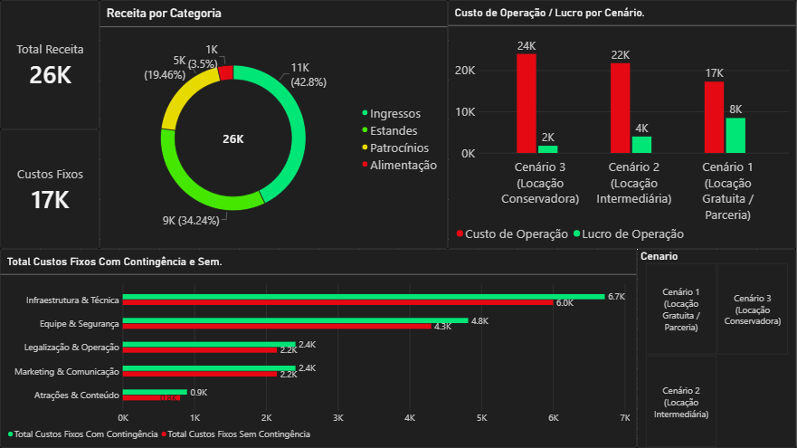

# 🎮 Vila Pixel Expo: Gestão de Dados e Viabilidade de um Festival Geek

> Estudo de caso prático de modelagem de dados, análise financeira e visualização executiva aplicada ao planejamento de um festival de jogos independentes.

---

## 🚀 O Projeto
A **Vila Pixel Expo** é um projeto conceitual de um festival geek e de jogos indie. O desafio original, proposto no curso de Gestão da Produção Industrial, era estruturar toda a viabilidade operacional, comercial e financeira de um evento de médio porte (350 visitantes, 20 estandes).

Para tirar o projeto do papel (ou do PowerPoint), desenvolvi este painel em Power BI. O objetivo foi transformar um plano de negócios estático em uma **ferramenta dinâmica para tomada de decisão**, permitindo simular cenários e identificar o ponto de equilíbrio financeiro.

---

## 📊 O que o Dashboard Resolve?
O painel foi modelado para responder a perguntas críticas de um gestor de eventos:
* **Qual a composição da receita?** (Ingressos vs. Estandes vs. Patrocínios).
* **Qual o impacto da locação no lucro?** Análise de sensibilidade com três cenários de espaço (Conservador, Intermediário e Parceria).
* **Qual o ponto de equilíbrio?** Quantos ingressos precisam ser vendidos para cobrir os custos fixos.

### 📈 Principais Indicadores (KPIs)
* **Receita Projetada:** R$ 25,7K (Divididos em 4 fontes).
* **Custos Operacionais:** R$ 17K+ (Com e sem reserva de contingência de 12%).
* **Análise de Cenários:** Teste de estresse financeiro alterando o custo de locação.
* **Ponto de Equilíbrio:** 237 ingressos.

---

## 📂 Modelagem de Dados
A base foi estruturada em Excel e importada para o Power BI, dividida em 4 tabelas principais:
1. **Receitas:** Faturamento bruto (Ingressos, Estandes, Patrocínios, Alimentação).
2. **Custos_Fixos:** Detalhamento de 12 categorias operacionais (infraestrutura, equipe, segurança, etc).
3. **Cenarios_Locacao:** Simulação de custos de espaço para análise de sensibilidade.
4. **Cronograma_Marketing:** Planejamento de 8 semanas de campanha.

---

## 🛠️ Tecnologias e Habilidades Aplicadas
* **Power BI & DAX:** Criação de medidas calculadas, KPIs e análise de sensibilidade.
* **Excel:** Modelagem de dados e estruturação de tabelas financeiras.
* **Design de UI/UX:** Tema escuro alinhado à identidade visual geek do evento.
* **Gestão de Projetos:** Aplicação de conceitos de viabilidade, análise de risco e ponto de equilíbrio.

---

## 🧠 O Maior Aprendizado (Soft Skill)
O primeiro rascunho deste projeto foi focado em impressionar o professor com viabilidade técnica. O feedback foi certeiro: *"Você fez os slides para mim, não para o público do evento"*. 

Aprendi que **dados e planejamento só têm valor se comunicados para o stakeholder certo**. A versão final do projeto (e deste dashboard) foca na experiência do visitante e na tomada de decisão ágil do organizador, sem perder o rigor técnico.

---

## 📂 Documentação e Apresentação
Você pode conferir a apresentação completa do projeto e os detalhes visuais do planejamento nos arquivos anexados:
- [`Apresentação - Vila Pixel Expo.pdf`](slides/slides.pdf)

---

## 👨‍💻 Sobre Mim
Sou **Enzo Miguel**, profissional em transição e desenvolvimento nas áreas de **Planejamento e Controle (PCM)**, Dados e Automação. Uno a vivência de chão de fábrica e ERP (TOTVS Protheus) com habilidades em BI (Power BI, DAX) e programação (Python, JS, C#) para resolver problemas reais.

*Em busca de oportunidades como Assistente/Analista Júnior de Dados, BI ou PCM.*